# Sistema de inventario – CRUD de productos

Proyecto académico desarrollado por **Dereck Moreno y Marcos Navarro**. Consiste en una aplicación web para administrar productos mediante operaciones de registro, búsqueda, modificación y consulta del inventario.

La aplicación utiliza **HTML, Bootstrap, JavaScript (Fetch API), PHP orientado a objetos y MySQL**. Las solicitudes se envían de forma asíncrona al servidor y las respuestas se procesan en formato JSON.

## 📑 Contenido
- [Objetivo](#-objetivo)
- [Tecnologías utilizadas](#-tecnologías-utilizadas)
- [Funciones del sistema](#-funciones-del-sistema)
- [Estructura del proyecto](#-estructura-del-proyecto)
- [Requisitos previos](#-requisitos-previos)
- [Instalación en WampServer](#-instalación-en-wampserver)
- [Base de datos](#-base-de-datos)
- [Descripción de archivos](#-descripción-de-archivos)
- [Validaciones y respuestas](#-validaciones-y-respuestas)
- [Evidencias de funcionamiento](#-evidencias-de-funcionamiento)
- [Autores](#-autores)

---

## 🎯 Objetivo

Desarrollar un CRUD de productos que permita registrar información en MySQL, buscar productos por su código, modificar sus datos y visualizar los registros existentes. El ejercicio aplica Fetch API y FormData para la comunicación entre JavaScript y PHP, programación orientada a objetos y consultas preparadas mediante PDO.

## 🧰 Tecnologías utilizadas

| Tecnología | Uso |
|---|---|
| HTML5 | Estructura del formulario y la tabla. |
| Bootstrap | Diseño y presentación de los componentes. |
| JavaScript | Eventos, validaciones y selección de acciones. |
| Fetch API y FormData | Envío asíncrono de datos al servidor. |
| PHP orientado a objetos | Procesamiento y organización de la lógica. |
| PDO | Conexión con MySQL y consultas preparadas. |
| MySQL | Almacenamiento de los productos. |
| SweetAlert2 | Mensajes visuales de éxito y error. |

## ⚙️ Funciones del sistema

- **Registrar productos:** guarda código, nombre, precio y cantidad.
- **Buscar por código:** recupera un producto y carga sus datos en el formulario.
- **Modificar productos:** actualiza la información del producto seleccionado.
- **Actualizar lista:** consulta los productos registrados y refresca la tabla.
- **Limpiar formulario:** deja los campos listos para otra operación.
- **Validar datos:** comprueba campos obligatorios y valores permitidos en el navegador y en el servidor.
- **Notificar resultados:** muestra mensajes de confirmación o error mediante SweetAlert2.

## 📁 Estructura del proyecto

```text
Tarea-del-CRUD/
├── Modelo/
│   ├── conexion.php
│   └── Productos.php
├── capturas/
│   ├── captura_01.png
│   ├── captura_02.png
│   ├── ...
│   └── captura_18.png
├── index.html
├── registrar.php
├── script.js
├── database.sql
└── README.md
```

## 💻 Requisitos previos

- Windows con WampServer (o XAMPP).
- Apache y MySQL/MariaDB activos.
- PHP con la extensión PDO MySQL habilitada.
- Navegador web actualizado.
- Conexión a Internet para cargar Bootstrap y SweetAlert2 desde sus CDN.

## 🚀 Instalación en WampServer

1. Descarga o clona este repositorio.
2. Copia la carpeta del proyecto dentro de `C:\wamp64\www\`.
3. Inicia Apache y MySQL desde WampServer y verifica que estén activos.
4. Abre phpMyAdmin: `http://localhost/phpmyadmin`.
5. Importa el archivo `database.sql`.
6. Revisa las credenciales en `Modelo/conexion.php`. La configuración local utilizada es:
   - Host: `localhost`
   - Base de datos: `productosdb`
   - Usuario: `root`
   - Contraseña: vacía
7. Si tu MySQL utiliza otras credenciales, actualiza esos valores en `Modelo/conexion.php`.
8. Abre el sistema en el navegador: `http://localhost/Tarea-del-CRUD/`.

> Si colocas el proyecto en una carpeta con otro nombre, sustituye `Tarea-del-CRUD` en la dirección por el nombre correspondiente.

## 🗄️ Base de datos

El sistema utiliza la base de datos **`productosdb`** y una tabla de productos con estos campos:

| Campo | Descripción |
|---|---|
| `id` | Identificador del registro. |
| `codigo` | Código del producto. |
| `producto` | Nombre o descripción del producto. |
| `precio` | Precio del producto. |
| `cantidad` | Unidades disponibles. |

La estructura SQL se encuentra en `database.sql`. Importa ese archivo antes de utilizar la aplicación.

## 🧩 Descripción de archivos

| Archivo | Responsabilidad |
|---|---|
| `index.html` | Interfaz: formulario, botones y tabla de productos. |
| `script.js` | Eventos, FormData, Fetch API, `switch` y alertas. |
| `registrar.php` | Recibe solicitudes POST, procesa la acción con `switch` y responde JSON. |
| `Modelo/conexion.php` | Clase `DB`: conexión PDO y consultas preparadas. |
| `Modelo/Productos.php` | Clase `Producto`: validaciones y operaciones de guardar, editar, buscar y listar. |
| `database.sql` | Creación de la base de datos y tabla requerida. |

## 🛡️ Validaciones y respuestas

El sistema combina validaciones del lado del cliente y del servidor:

- Los campos del formulario son obligatorios.
- El precio debe ser numérico y no negativo.
- La cantidad debe ser un número entero y no negativo.
- El código del producto debe ser único.
- PHP vuelve a validar los datos antes de ejecutar las operaciones.
- Las consultas a MySQL utilizan PDO y parámetros preparados.

El servidor devuelve respuestas JSON con propiedades como:

- `success`: indica si la operación se completó.
- `message`: describe el resultado.
- `accion`: identifica la operación procesada.
- `errors`: contiene los errores de validación, si existen.

JavaScript interpreta la respuesta y muestra el resultado mediante SweetAlert2.

## 🖼️ Evidencias de funcionamiento

A continuación se incluyen las capturas del desarrollo y las pruebas. Cada imagen tiene una breve explicación. Las imágenes están almacenadas en `capturas/`, por lo que GitHub podrá mostrarlas directamente al abrir este README.


### Interfaz del sistema de inventario

Se observa la pantalla principal del CRUD, con el formulario para introducir el código, nombre, precio y cantidad del producto, además de la tabla donde se muestran los productos registrados.

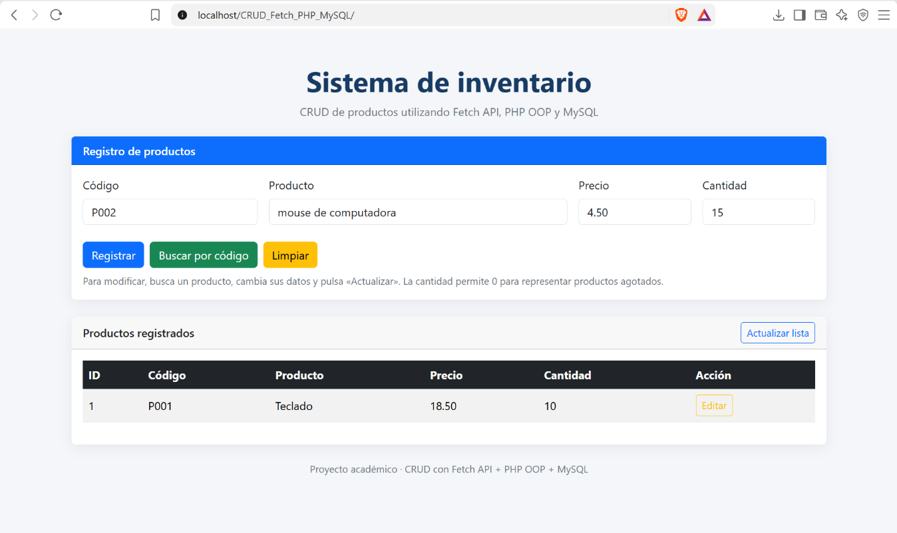


### Procesamiento de operaciones en PHP

Esta captura muestra parte de `registrar.php`, donde se reciben los datos enviados desde el formulario, se validan los campos y se prepara la ejecución de la operación solicitada.

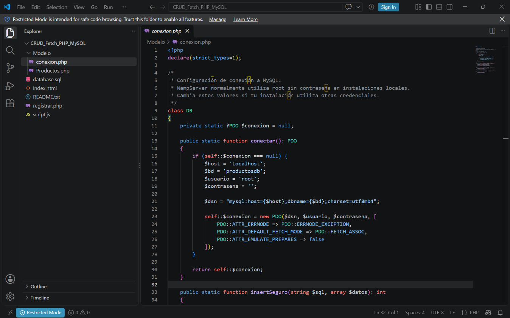


### Casos del switch en PHP

Se observa la estructura `switch` utilizada en el servidor para separar las acciones del CRUD, como guardar, modificar, buscar y listar productos.

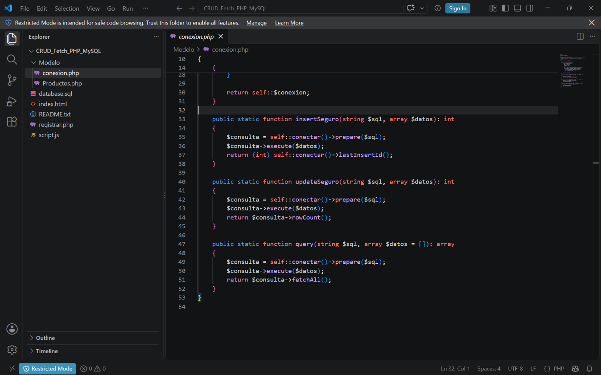


### Validación y preparación de la respuesta

La captura presenta la continuación de la lógica PHP: validaciones de los datos y construcción de las respuestas que se envían al navegador.

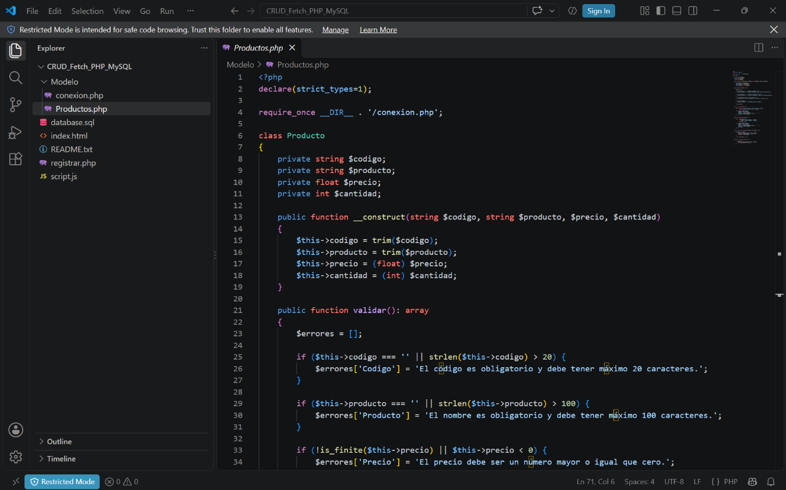


### Comunicación con Fetch API

Se muestra el código JavaScript que prepara los datos del formulario y los envía al archivo PHP mediante Fetch API y FormData. También se aprecia el control de la acción que se ejecutará.

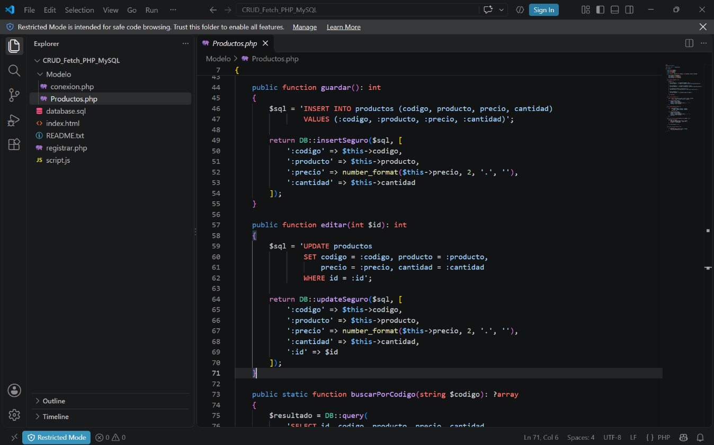


### Manejo de resultados y eventos

Esta parte del JavaScript procesa la respuesta recibida, actualiza la interfaz y maneja los eventos de los botones del sistema.

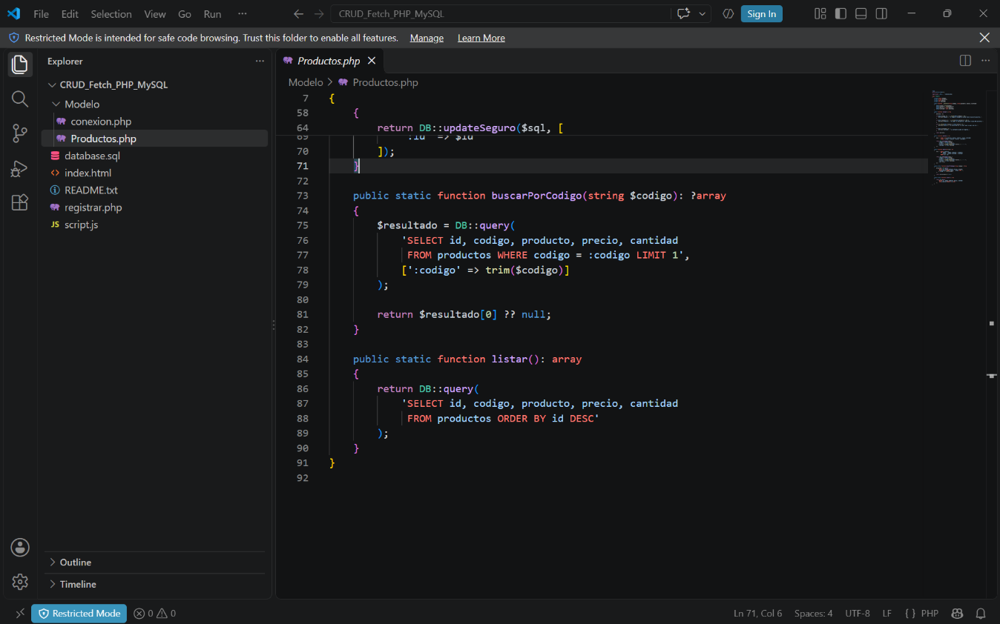


### Formulario HTML y validaciones

Se observa el formulario HTML del inventario y sus controles de entrada, incluyendo atributos para validar que los campos requeridos tengan valores.

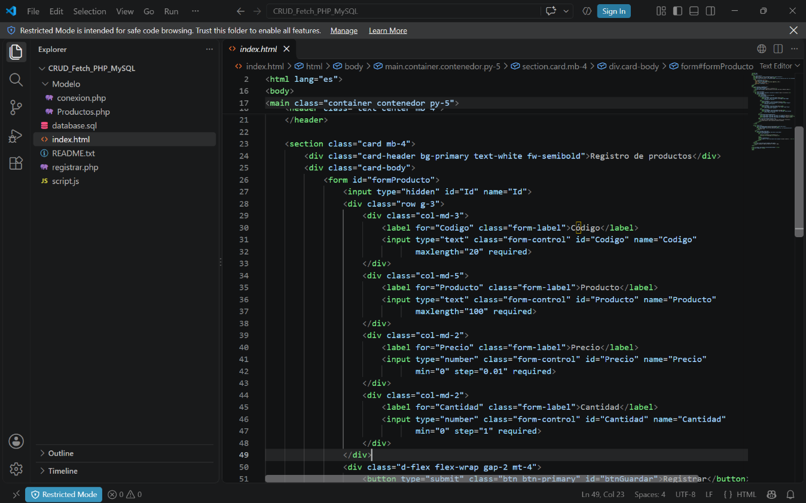


### Respuesta JSON en las herramientas del navegador

La captura muestra la respuesta del servidor en las herramientas de desarrollo del navegador. Permite comprobar que los datos se devuelven estructurados en formato JSON.

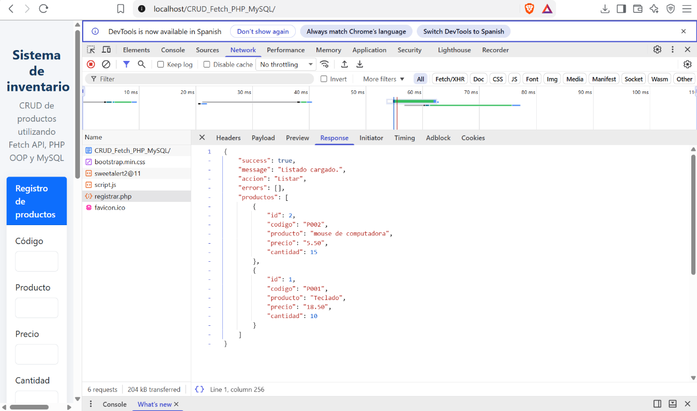


### Vista de los productos registrados

Se presenta el sistema con los productos cargados en la tabla, lo que permite visualizar el resultado de la consulta de registros.

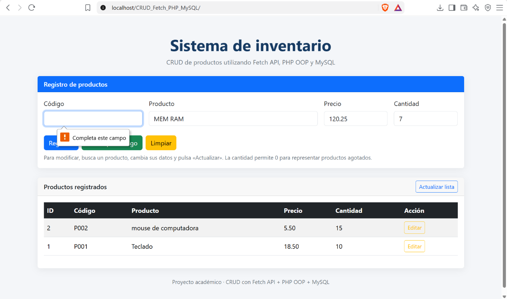


### Validación de código duplicado

Al intentar registrar un producto con un código que ya existe, el sistema muestra una alerta indicando que el código debe ser único. Esto demuestra la validación de duplicados.

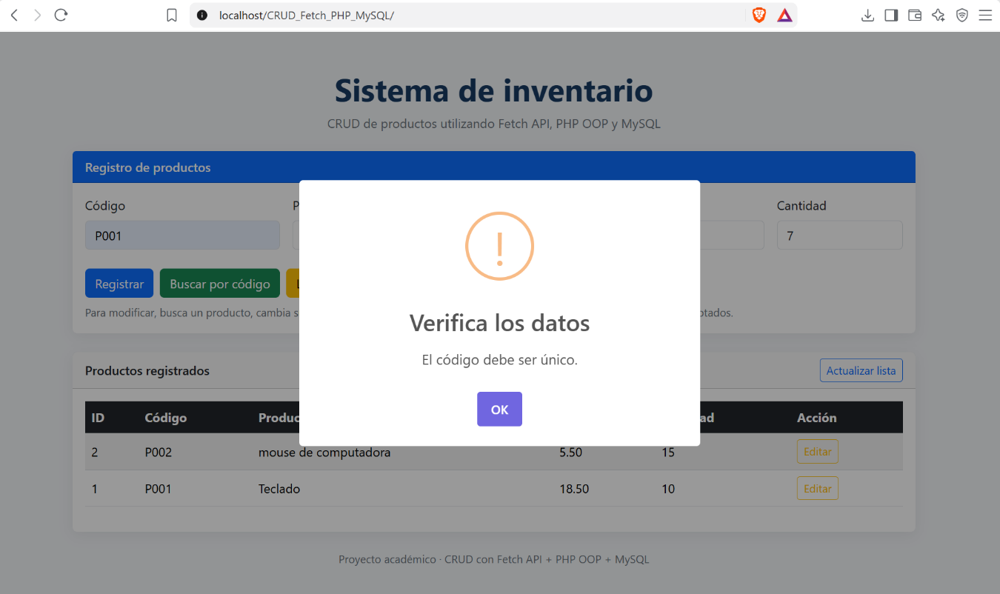


### Confirmación de registro exitoso

La alerta confirma que el producto se registró correctamente y que la operación terminó sin errores.

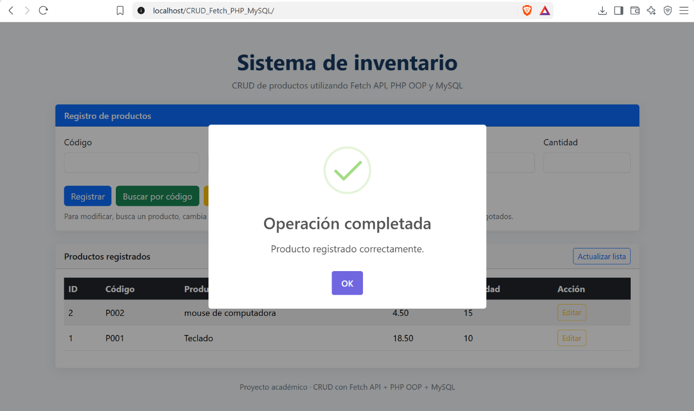


### Formulario y listado actualizado

Se observa nuevamente la interfaz junto con la lista de productos, donde se puede verificar la información guardada en la base de datos.


### Resultado de búsqueda por código

La ventana de confirmación indica que el producto solicitado fue encontrado. Sus datos se cargan en el formulario para poder revisarlos o modificarlos.

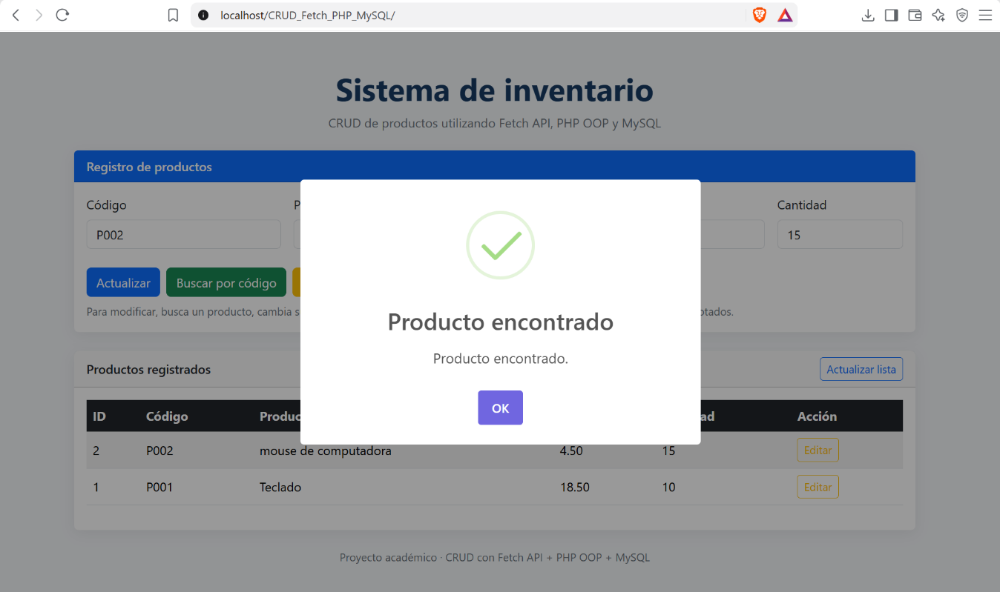


### Producto cargado en el formulario

Se muestra el producto recuperado mediante la búsqueda por código, con sus valores visibles en los campos del formulario.

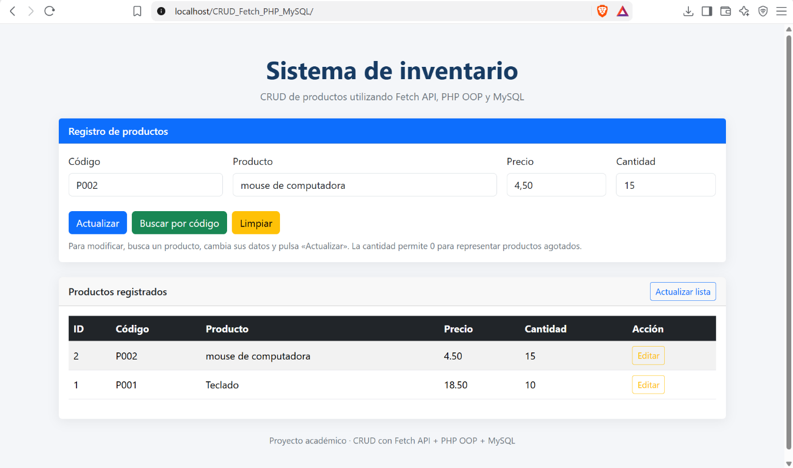


### Confirmación de modificación

La alerta indica que el producto fue actualizado correctamente después de modificar sus datos.

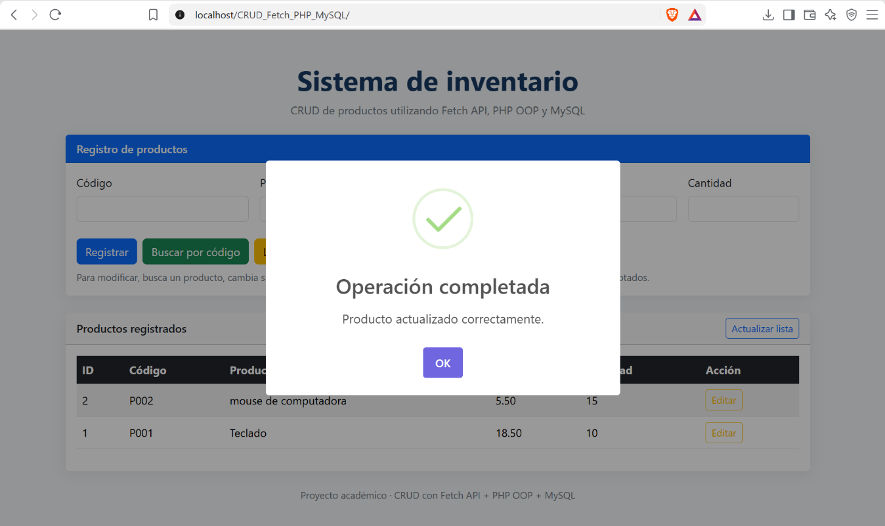


### Clase DB y conexión PDO

La captura muestra parte de la clase `DB`, responsable de establecer la conexión con MySQL mediante PDO y centralizar el acceso a la base de datos.

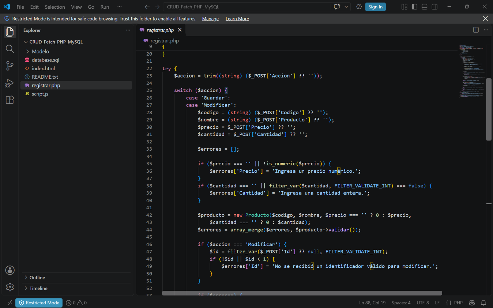


### Consultas preparadas y métodos de base de datos

Se observan métodos de la clase de conexión que utilizan consultas preparadas para ejecutar operaciones de inserción, actualización y consulta.

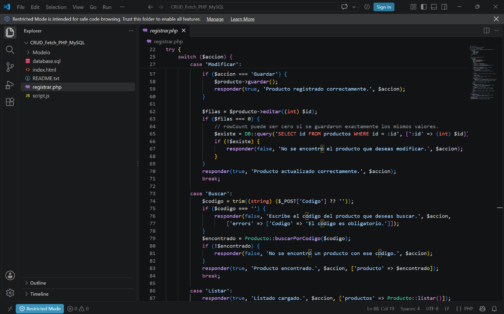


### Clase Producto y validaciones

Esta captura presenta parte de la clase `Producto`, donde se organizan los atributos del producto y la lógica de validación antes de realizar las operaciones sobre la base de datos.

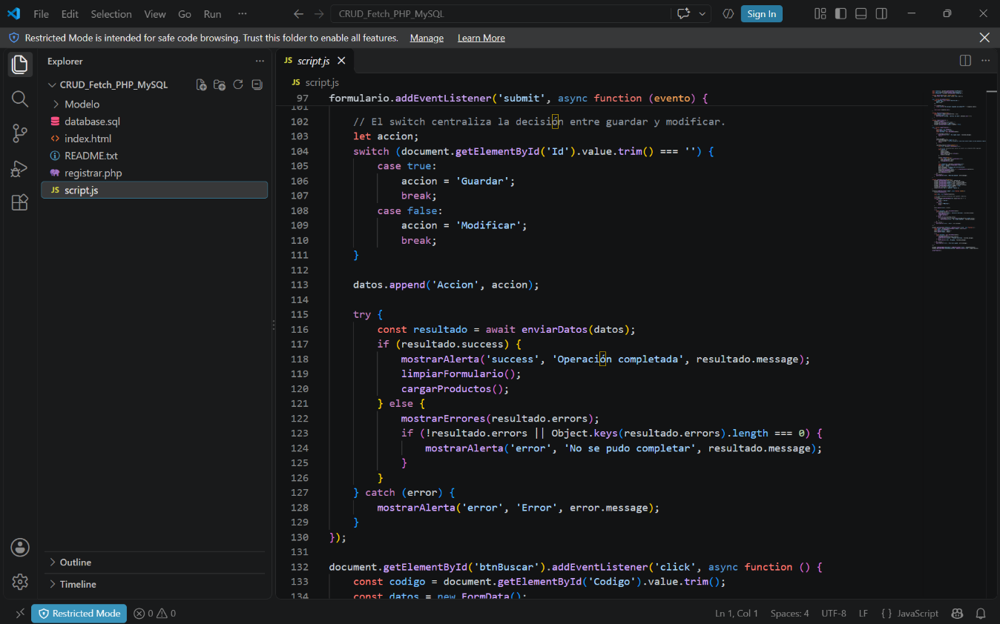

## 👥 Autores

**Dereck Moreno**  
**Marcos Navarro**

Proyecto académico de desarrollo web.
